<div align="center">

<a href="https://thenuxofc.store/">
  
</a>


<br/>

<a href="https://github.com/thenuxofc"></a>
<a href="https://github.com/thenuxofc?tab=followers"></a>
<a href="https://github.com/thenuxofc"></a>


</div>



<div align="center">

<table>
<tr>
<td align="center" width="200"><b>AI</b><br/>Agents / LLMs<br/>Tools / Automation</td>
<td align="center" width="200"><b>BACKEND</b><br/>APIs / Edge<br/>Cloud / Systems</td>
<td align="center" width="200"><b>PRODUCT</b><br/>Web / SaaS<br/>UI / UX</td>
<td align="center" width="200"><b>SOFTWARE</b><br/>Desktop / Mobile<br/>Developer Tools</td>
</tr>
</table>

</div>

I'm **Thenux**, an independent developer from **Sri Lanka**, building software across AI, web, APIs, developer infrastructure, desktop applications, automation and productivity.

<div align="center">


</div>

| | |
| :-- | :-- |
| **Name** | THENUX |
| **Role** | Independent Developer and AI Builder |
| **Location** | Sri Lanka (Asia/Colombo) |
| **Focus** | AI, AI Agents, Developer Tools, API Infrastructure, Modern Web Apps, Desktop Software, Automation, Productivity, Security, Cloud and Edge |
| **Main stack** | JavaScript, TypeScript, Python, React, Node.js, Vite, Electron, Firebase, Cloudflare Workers |
| **Philosophy** | Build, Ship, Learn, Improve |
| **Status** | Online and building |

I enjoy taking an idea all the way: **idea, research, architecture, UI/UX, code, backend, security, deployment, real users, iterate.**
I'm most interested in the intersection of **Artificial Intelligence x Software Engineering x Product Design x Developer Experience**, and instead of only experimenting with individual technologies I'm building a growing ecosystem under the **THENUX** name.


<div align="center">
</div>


<div align="center">
<table>
<tr>
<td><a href="https://ai.thenuxofc.store/"></a></td>
<td><a href="https://api.thenuxofc.store/"></a></td>
</tr>
<tr>
<td><a href="https://github.com/thenuxofc/thenux-cli"></a></td>
<td><a href="https://github.com/thenuxofc/T.H.E.N.U.X-JARVIS-V3"></a></td>
</tr>
<tr>
<td><a href="https://mail.thenuxofc.store/"></a></td>
<td><a href="https://thenuxofc.store/"></a></td>
</tr>
<tr>
<td><a href="https://thenuxofc.store/"></a></td>
<td><a href="https://thenuxofc.store/"></a></td>
</tr>
</table>
</div>

<details>
<summary><b>THENUX AI</b> - core areas</summary>

<br/>

More than a simple chatbot: AI models, streaming, tools, developer workflows, authentication, web capabilities and application-generation concepts in one platform.

`AI conversations` `Multi-model architecture` `Streaming responses` `Web search` `Tools / skills / plugins` `Vision` `Voice` `Developer workflows` `AI application generation` `Web application generation` `Authentication` `Workspace concepts` `Cloudflare edge infrastructure` `Security / anti-abuse architecture`

</details>

<details>
<summary><b>THENUX API</b> - concepts and surface</summary>

<br/>

The developer infrastructure layer around the THENUX ecosystem.

`REST` `Streaming APIs` `Server-Sent Events` `API keys` `Usage tracking` `Rate limiting` `Model routing` `Developer docs` `Image / media endpoints` `Voice endpoints` `Cloudflare edge`

```text
/api/chat                      /api/image
/api/stream                    /api/video
/api/models                    /api/voice/chat
/api/plans                     /api/chats/:id/messages/stream
/api/usage
/api/key/create
```

</details>

<details>
<summary><b>THENUX CLI</b> - AI developer agent in the terminal</summary>

<br/>

Bringing AI-assisted development into the shell: **understand, plan, modify, execute.**

`AI coding agents` `CLI interfaces` `Project inspection` `Code generation` `File manipulation` `Developer workflows` `AI-assisted automation` `THENUX API integration`

</details>

<details>
<summary><b>JARVIS</b> - one of my longest-running AI desktop projects</summary>

<br/>

`AI assistants` `Voice interaction` `LLM integration` `Desktop interfaces` `System automation` `Coding assistance` `Tool integration` `Windows desktop workflows`

</details>

<details>
<summary><b>THENUX MAIL, SCHOLAR and STUDY</b></summary>

<br/>

**Mail** - a developer-focused email and verification portal experiment: email workflows, verification codes, fast web UI, Firebase-backed architecture, responsive interface.

**Scholar** - AI-powered study and productivity experimentation. The idea is to make AI part of the actual learning workflow rather than putting a chatbot next to a textbook: study assistance, notes, focus, study sessions, productivity, desktop study environment.

**Study / Lock-in** - a focus-oriented software concept built around distraction resistance, with three levels: **Casual** (flexible focus), **Strict** (reduced distractions) and **Hardcore** (maximum lock-in). The goal is to encourage actual focused work, not just display productivity statistics.

</details>

| Project | Area | Description |
| :-- | :-- | :-- |
| **Reply AI** | Android / AI | AI assistant experimentation |
| **ROOTCODE** | Developer Tools | Coding and developer experiments |
| **GlucoGuide / AQUINAS** | Applications | Practical application experiments |
| **THENUX Billing** | Business Software | Billing / workflow experimentation |
| **THENUX Hosting** | Infrastructure | Hosting / deployment experiments |
| **THENUX Drop** | Web | Interactive developer experiments |

> Not every project is intended to become a giant platform. Some projects exist to explore an idea, technology or architecture.


<div align="center">


<br/>

**Application and general purpose**<br/>


**Systems and performance**<br/>


**Functional, data and scientific**<br/>


**Web, query and scripting**<br/>

</div>


<div align="center">

| Area | Icons | Technologies |
| :-- | :-- | :-- |
| **Frontend** |  | `React` `Next.js` `Vite` `React Native` `Tailwind CSS` `Framer Motion` `GSAP` `ScrollTrigger` `Lenis` `Three.js` `WebGL` `Web Audio API` `PWA` `Design systems` |
| **Backend** |  | `Node.js` `Express` `FastAPI` `REST` `GraphQL` `WebSockets` `SSE` `Middleware` `Auth` `Rate limiting` `API keys` `Streaming` `Serverless` |
| **Data** |  | `Firebase` `Firestore` `MongoDB` `MySQL` `PostgreSQL` `SQLite` `Supabase` `Redis` `Prisma` `Realtime DBs` |
| **AI / ML** |  | `LLMs` `AI agents` `Tool calling` `Multi-model routing` `Prompt engineering` `Vision` `Speech-to-text` `Text-to-speech` `RAG` `Embeddings` `Ollama` `OpenAI APIs` `Anthropic APIs` `Hugging Face` `LangChain` `Whisper` `Model fallback` |
| **Desktop** |  | `Electron` `PyQt6` `PyInstaller` `Electron Builder` `Inno Setup` `IPC` `Local models` `Windows apps` |
| **Mobile** |  | `Android` `Kotlin` `Jetpack Compose` `React Native` `APK packaging` `Mobile API integration` |
| **Cloud and edge** |  | `Cloudflare Workers` `Cloudflare Pages` `Firebase` `Google Cloud` `Vercel` `Netlify` `Docker` `CDN` `DNS` `Edge computing` |
| **Automation** |  | `Puppeteer` `Playwright` `Web scraping` `API automation` `Workflow automation` `Deployment automation` |
| **Tools** |  | `Git` `GitHub` `VS Code` `Antigravity` `Cline` `Postman` `Figma` `Canva` `Blender` `Google AI Studio` `Ollama` |

</div>

**Security and authentication** - security is treated as part of the architecture rather than something added after deployment.

`Firebase Auth` `API key management` `Token-based systems` `Access control` `Rate limiting` `Anti-abuse` `Request validation` `CORS` `Security headers` `Cloudflare protection` `Bot protection` `HMAC` `Cryptographic request validation` `Session management` `Secret management`

**Design and UI engineering** - interfaces that feel like products, not generated templates.

`Apple-style` `Linear-style` `Vercel-inspired` `Developer dashboards` `Glassmorphism` `Dark interfaces` `Soft gradients` `Animated backgrounds` `Micro-interactions` `Motion design` `Mobile-first` `High-FPS animation` `WebGL` `3D interfaces` `Accessibility` `Performance-oriented UI`


<div align="center">
</div>


<div align="center">
</div>


<div align="center">


<br/><br/>


<br/><br/>

<picture>
<source media="(prefers-color-scheme: dark)" srcset="https://raw.githubusercontent.com/thenuxofc/thenuxofc/output/github-contribution-grid-snake-dark.svg">
<source media="(prefers-color-scheme: light)" srcset="https://raw.githubusercontent.com/thenuxofc/thenuxofc/output/github-contribution-grid-snake.svg">

</picture>

<br/><br/>

<a href="https://thenuxdrop.netlify.app/arcade"></a>

</div>


<div align="center">
</div>

| Area | Current direction |
| :-- | :-- |
| **AI Agents** | Tool calling, planning, model routing |
| **Real-time AI** | SSE, streaming, low-latency interfaces |
| **API Infrastructure** | Developer APIs, auth, quotas, usage |
| **Security** | Edge protection, anti-abuse, secure APIs |
| **Edge Computing** | Cloudflare Workers, serverless architecture |
| **Developer Experience** | CLI agents, dashboards, tooling |
| **AI + Education** | Study systems, focus tools, learning workflows |
| **Product Design** | Motion, interaction, premium interfaces |

<details>
<summary><b>Project map</b></summary>

<br/>

| Group | Projects |
| :-- | :-- |
| **AI** | THENUX AI, JARVIS, Reply AI, AI experiments |
| **Infrastructure** | THENUX API, THENUX Hosting, Cloud / edge experiments |
| **Developer tools** | THENUX CLI, ROOTCODE, Developer utilities |
| **Web** | THENUX Mail, THENUX websites, SaaS experiments, Interactive web projects |
| **Productivity** | THENUX Scholar, THENUX Study, Lock-in systems |
| **Applications** | Billing, GlucoGuide, AQUINAS, Other experiments |
| **Experiments** | AI, WebGL, Automation, Desktop, New ideas |

</details>


<div align="center">

### Don't just use technology. Build with it.

I want to keep learning, building and shipping software that is actually useful.

**AI  /  Infrastructure  /  Products  /  Developer Tools  /  Applications**

`Build.` `Break.` `Learn.` `Rebuild.` `Ship.`

</div>

**Principles:** build something real. Ship, observe, learn, improve. Good UX is engineering. Security is architecture. Performance is a feature. Documentation is part of the product. Open source is a multiplier. Every failed experiment is useful data.


<div align="center">

<a href="https://github.com/thenuxofc"></a>
<a href="https://thenuxofc.store/"></a>
<a href="https://ai.thenuxofc.store/"></a>
<a href="https://api.thenuxofc.store/"></a>
<a href="https://instagram.com/thenux_ofc"></a>
<a href="https://linkedin.com/in/thenuxofc"></a>
<a href="mailto:sup@thenuxofc.store"></a>

<br/><br/>

**Open to interesting collaborations, projects and ideas.**

Built from Sri Lanka. Shared with the world.

<br/>

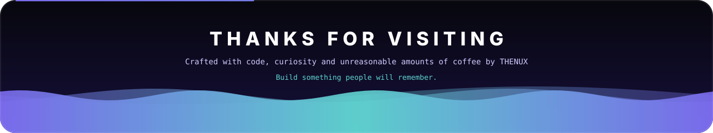

</div>
