<div align="center">

<a href="https://thenuxofc.store/">
  
</a>

<h1>Thenux: Web Developer and AI Engineer from Sri Lanka</h1>


<p>
<b>Sri Lankan full-stack web developer</b> building fast React and Next.js websites, AI-powered apps, Android apps in Kotlin,
WhatsApp bots, VS Code extensions and developer APIs. Working in English and Sinhala, available worldwide.
</p>

<a href="https://github.com/thenuxofc"></a>
<a href="https://github.com/thenuxofc?tab=followers"></a>
<a href="https://github.com/thenuxofc"></a>


<br/><br/>

<a href="https://thenuxofc.store/"></a>

</div>


I'm **Thenux**, an independent developer from **Sri Lanka** building software across AI, web, APIs, developer infrastructure, desktop applications, automation and productivity.
I take an idea all the way: **idea, research, architecture, UI/UX, code, backend, security, deployment, real users, iterate.**
I care most about the intersection of **Artificial Intelligence x Software Engineering x Product Design x Developer Experience**, and I'm building a growing ecosystem under the **THENUX** name.

<div align="center">


</div>

| | |
| :-- | :-- |
| **Name** | THENUX |
| **Role** | Independent Developer and AI Builder |
| **Location** | Sri Lanka (Asia/Colombo) |
| **Languages spoken** | English and Sinhala |
| **Focus** | AI, AI Agents, Developer Tools, API Infrastructure, Modern Web Apps, Desktop Software, Automation, Productivity, Security, Cloud and Edge |
| **Main stack** | JavaScript, TypeScript, Python, React, Next.js, Node.js, Vite, Electron, Firebase, Cloudflare Workers |
| **Philosophy** | Build, Ship, Learn, Improve |
| **Status** | Open for projects |

<div align="center">
</div>


<div align="center">
</div>

<div align="center">
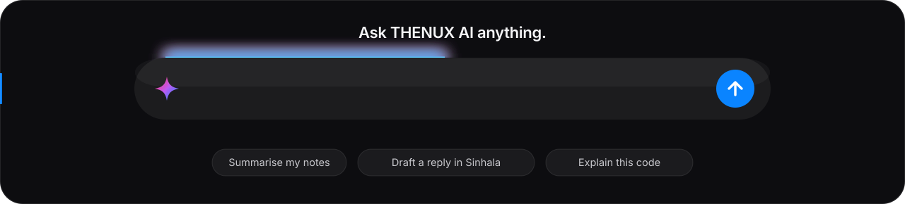
<br/><br/>
</div>

### Services

| Service | What you get | Typical stack |
| :-- | :-- | :-- |
| **Websites and web apps** | Fast, responsive, accessible sites and SaaS dashboards with polished motion | React, Next.js, TypeScript, Tailwind CSS, Framer Motion, GSAP, Three.js |
| **AI products** | Chat apps, streaming assistants, tool-calling agents, search and vision features | LLM APIs, SSE streaming, Cloudflare Workers, Python |
| **Android apps** | Native apps with floating assistants, accessibility services and Material design | Kotlin, Jetpack Compose |
| **WhatsApp and chat bots** | Multi-number bots, admin panels, bilingual Sinhala and English replies | Node.js, Baileys, Firebase, MongoDB |
| **VS Code extensions** | Polished sidebar chat and developer workflow tooling | TypeScript, VS Code API |
| **APIs and backends** | Auth, API keys, rate limits, usage tracking, streaming endpoints | REST, SSE, Workers, Firebase, Netlify Functions |
| **Landing pages and brands** | Product pages, teaser pages, design systems and animated brand assets | HTML, CSS, SVG, WebGL |


<div align="center">

</div>


<div align="center">
<table>
<tr>
<td><a href="https://ai.thenuxofc.store/"></a></td>
<td><a href="https://api.thenuxofc.store/"></a></td>
</tr>
<tr>
<td><a href="https://github.com/thenuxofc/thenux-cli"></a></td>
<td><a href="https://github.com/thenuxofc/T.H.E.N.U.X-JARVIS-V3"></a></td>
</tr>
<tr>
<td><a href="https://mail.thenuxofc.store/"></a></td>
<td><a href="https://thenuxofc.store/"></a></td>
</tr>
<tr>
<td><a href="https://thenuxofc.store/"></a></td>
<td><a href="https://thenuxofc.store/"></a></td>
</tr>
</table>
</div>

<details>
<summary><b>THENUX AI</b> - core areas</summary>

<br/>

More than a simple chatbot: AI models, streaming, tools, developer workflows, authentication, web capabilities and application-generation concepts in one platform, with a web app, a self-hosted backend and a VS Code extension.

`AI conversations` `Multi-model architecture` `Streaming responses` `Web search` `Tools / skills / plugins` `Vision` `Voice` `Developer workflows` `AI application generation` `Web application generation` `Authentication` `Workspace concepts` `Cloudflare edge infrastructure` `Security / anti-abuse architecture`

</details>

<details>
<summary><b>THENUX API</b> - concepts and surface</summary>

<br/>

The developer infrastructure layer around the THENUX ecosystem.

`REST` `Streaming APIs` `Server-Sent Events` `API keys` `Usage tracking` `Rate limiting` `Model routing` `Developer docs` `Image / media endpoints` `Voice endpoints` `Cloudflare edge`

```text
/api/chat                      /api/image
/api/stream                    /api/video
/api/models                    /api/voice/chat
/api/plans                     /api/chats/:id/messages/stream
/api/usage
/api/key/create
```

</details>

<details>
<summary><b>THENUX CLI</b> - AI developer agent in the terminal</summary>

<br/>

Bringing AI-assisted development into the shell: **understand, plan, modify, execute.**

`AI coding agents` `CLI interfaces` `Project inspection` `Code generation` `File manipulation` `Developer workflows` `AI-assisted automation` `THENUX API integration`

</details>

<details>
<summary><b>JARVIS</b> - one of my longest-running AI desktop projects</summary>

<br/>

A Python and PyQt6 voice and visual AI assistant for Windows.

`AI assistants` `Voice interaction` `LLM integration` `Desktop interfaces` `System automation` `Coding assistance` `Tool integration` `Windows desktop workflows`

</details>

<details>
<summary><b>THENUX MAIL, SCHOLAR and STUDY</b></summary>

<br/>

**Mail** - a developer-focused email and verification portal experiment: email workflows, verification codes, fast web UI, Firebase-backed architecture, responsive interface.

**Scholar** - AI-powered study and productivity experimentation. The idea is to make AI part of the actual learning workflow rather than putting a chatbot next to a textbook: study assistance, notes, focus, study sessions, productivity, desktop study environment.

**Study / Lock-in** - a focus-oriented software concept built around distraction resistance, with three levels: **Casual** (flexible focus), **Strict** (reduced distractions) and **Hardcore** (maximum lock-in). The goal is to encourage actual focused work, not just display productivity statistics.

</details>

### More products

| Product | Area | Description |
| :-- | :-- | :-- |
| **[ROOTCODE](https://game.thenuxofc.store)** | Game / Education | A JavaScript-learning action-adventure game with an interactive design document, focus mode, Sinhala translation engine and visual concept cards |
| **Reply AI** | Android / AI | Floating AI reply assistant for WhatsApp, Instagram, Telegram, Gmail and SMS with six reply tones (Kotlin, Jetpack Compose, AccessibilityService) |
| **SULA MD** | Bot platform | WhatsApp bot management platform with pairing, settings, premium, community chat, admin panel and bilingual AI support |
| **THENUX MD** | WhatsApp bot | Multi-number WhatsApp bot in Node.js with Baileys and local session storage |
| **README Generator** | SaaS | Full-stack AI README generator with auth, Firestore and serverless functions |
| **NoTrack.ai** | Privacy / API | A no-log chat API with its own test page |
| **GlucoGuide / AQUINAS** | Applications | Practical application experiments |
| **THENUX Billing** | Business software | Billing and workflow experimentation |
| **THENUX Hosting** | Infrastructure | Hosting and deployment experiments |
| **THENUX Drop** | Web | Interactive developer experiments |
| **Portfolio site** | Web | Portfolio at [thenuxofc.store](https://thenuxofc.store) built with Next.js and React |

> Not every project is intended to become a giant platform. Some projects exist to explore an idea, technology or architecture.


<div align="center">
</div>


<div align="center">
</div>


<div align="center">
</div>


<div align="center">
<br/><br/>
<br/><br/>
</div>


<div align="center">
</div>

### The web developer toolkit

| Principle | How it shows up in the work |
| :-- | :-- |
| **Performance first** | Lean bundles, lazy loading, optimized images and fonts, smooth 60 FPS motion |
| **Responsive and mobile-first** | Layouts that adapt from phone to ultrawide, touch-friendly interactions |
| **Accessible by default** | Semantic HTML, keyboard navigation, contrast, reduced-motion support |
| **SEO ready** | Clean markup, metadata, Open Graph cards, sitemaps, structured data, fast Core Web Vitals |
| **Motion with purpose** | Framer Motion, GSAP and ScrollTrigger, Lenis smooth scroll, springs over fixed timings |
| **3D and WebGL** | Three.js scenes, shaders, interactive hero experiences |
| **Real backends** | Auth, Firestore, serverless functions, REST and SSE APIs, rate limiting |
| **Multilingual** | English and Sinhala interfaces, translation engines |
| **Deploy and ship** | Netlify, Vercel, Cloudflare Pages and Workers, CI, custom domains |
| **Design systems** | Reusable tokens, components and brand assets, from Apple-style glass to bold editorial |


<div align="center">

<br/>

**Application and general purpose**<br/>


**Systems and performance**<br/>


**Functional, data and scientific**<br/>


**Web, query and scripting**<br/>

</div>


<div align="center">

| Area | Icons | Technologies |
| :-- | :-- | :-- |
| **Frontend** |  | `React` `Next.js` `Vite` `React Native` `Tailwind CSS` `Framer Motion` `GSAP` `ScrollTrigger` `Lenis` `Three.js` `WebGL` `Web Audio API` `PWA` `Design systems` |
| **Backend** |  | `Node.js` `Express` `FastAPI` `REST` `GraphQL` `WebSockets` `SSE` `Middleware` `Auth` `Rate limiting` `API keys` `Streaming` `Serverless` |
| **Data** |  | `Firebase` `Firestore` `MongoDB` `MySQL` `PostgreSQL` `SQLite` `Supabase` `Redis` `Prisma` `Realtime DBs` |
| **AI / ML** |  | `LLMs` `AI agents` `Tool calling` `Multi-model routing` `Prompt engineering` `Vision` `Speech-to-text` `Text-to-speech` `RAG` `Embeddings` `Ollama` `OpenAI APIs` `Anthropic APIs` `Hugging Face` `LangChain` `Whisper` `Model fallback` |
| **Desktop** |  | `Electron` `PyQt6` `PyInstaller` `Electron Builder` `Inno Setup` `IPC` `Local models` `Windows apps` |
| **Mobile** |  | `Android` `Kotlin` `Jetpack Compose` `React Native` `APK packaging` `Mobile API integration` |
| **Cloud and edge** |  | `Cloudflare Workers` `Cloudflare Pages` `Firebase` `Google Cloud` `Vercel` `Netlify` `Docker` `CDN` `DNS` `Edge computing` |
| **Automation** |  | `Puppeteer` `Playwright` `Web scraping` `API automation` `Workflow automation` `Deployment automation` |
| **Tools** |  | `Git` `GitHub` `VS Code` `Antigravity` `Cline` `Postman` `Figma` `Canva` `Blender` `Google AI Studio` `Ollama` |

</div>

**Security and authentication** - security is treated as part of the architecture rather than something added after deployment.

`Firebase Auth` `API key management` `Token-based systems` `Access control` `Rate limiting` `Anti-abuse` `Request validation` `CORS` `Security headers` `Cloudflare protection` `Bot protection` `HMAC` `Cryptographic request validation` `Session management` `Secret management`

**Design and UI engineering** - interfaces that feel like products, not generated templates.

`Apple-style` `Linear-style` `Vercel-inspired` `Developer dashboards` `Glassmorphism` `Dark interfaces` `Soft gradients` `Animated backgrounds` `Micro-interactions` `Motion design` `Mobile-first` `High-FPS animation` `WebGL` `3D interfaces` `Accessibility` `Performance-oriented UI`


<div align="center">

</div>


<div align="center">

</div>


<div align="center">


<br/><br/>


<br/><br/>

<picture>
<source media="(prefers-color-scheme: dark)" srcset="https://raw.githubusercontent.com/thenuxofc/thenuxofc/output/github-contribution-grid-snake-dark.svg">
<source media="(prefers-color-scheme: light)" srcset="https://raw.githubusercontent.com/thenuxofc/thenuxofc/output/github-contribution-grid-snake.svg">

</picture>

<br/><br/>

<a href="https://thenuxdrop.netlify.app/arcade"></a>

</div>


<div align="center">

</div>

| Area | Current direction |
| :-- | :-- |
| **AI Agents** | Tool calling, planning, model routing |
| **Real-time AI** | SSE, streaming, low-latency interfaces |
| **API Infrastructure** | Developer APIs, auth, quotas, usage |
| **Security** | Edge protection, anti-abuse, secure APIs |
| **Edge Computing** | Cloudflare Workers, serverless architecture |
| **Developer Experience** | CLI agents, dashboards, tooling |
| **AI + Education** | Study systems, focus tools, learning workflows |
| **Product Design** | Motion, interaction, premium interfaces |


<details>
<summary><b>I'm looking for a web developer in Sri Lanka. Can you help?</b></summary>

<br/>

Yes. I build business sites, landing pages, portfolios, SaaS dashboards and web apps with React and Next.js for clients in Sri Lanka and abroad. I can write the interface in English, Sinhala or both.

</details>

<details>
<summary><b>Do you build AI-powered apps and chatbots?</b></summary>

<br/>

Yes. I build chat assistants, streaming AI interfaces, tool-calling agents and AI-assisted developer tools, including a full AI platform, a VS Code extension, a CLI agent and bilingual WhatsApp bots.

</details>

<details>
<summary><b>Can you build Android apps and WhatsApp bots?</b></summary>

<br/>

Yes. Android apps are built natively in Kotlin with Jetpack Compose. WhatsApp bots are built in Node.js, including multi-number setups with admin dashboards.

</details>

<details>
<summary><b>What does a project look like from start to finish?</b></summary>

<br/>

Idea and research, design, architecture, build, security, testing, deployment, then observing real usage and iterating. The workflow animation above shows the ten steps.

</details>

<details>
<summary><b>How do I start?</b></summary>

<br/>

Email **[sup@thenuxofc.store](mailto:sup@thenuxofc.store)** with a short description of what you want to build, or visit **[thenuxofc.store](https://thenuxofc.store/)**.

</details>


<div align="center">

### Don't just use technology. Build with it.

I want to keep learning, building and shipping software that is actually useful.

**AI  /  Infrastructure  /  Products  /  Developer Tools  /  Applications**

`Build.` `Break.` `Learn.` `Rebuild.` `Ship.`

</div>

**Principles:** build something real. Ship, observe, learn, improve. Good UX is engineering. Security is architecture. Performance is a feature. Documentation is part of the product. Open source is a multiplier. Every failed experiment is useful data.


<div align="center">

<a href="https://github.com/thenuxofc"></a>
<a href="https://thenuxofc.store/"></a>
<a href="https://ai.thenuxofc.store/"></a>
<a href="https://api.thenuxofc.store/"></a>
<a href="https://instagram.com/thenux_ofc"></a>
<a href="https://linkedin.com/in/thenuxofc"></a>
<a href="mailto:sup@thenuxofc.store"></a>

<br/><br/>


<br/><br/>

**Open to interesting collaborations, projects and ideas.**

Built from Sri Lanka. Shared with the world.

<br/>


<sub>Topics: Sri Lanka web developer, React developer, Next.js developer, AI application developer, Android Kotlin developer, WhatsApp bot developer, VS Code extension developer, freelance full-stack developer.</sub>

</div>
